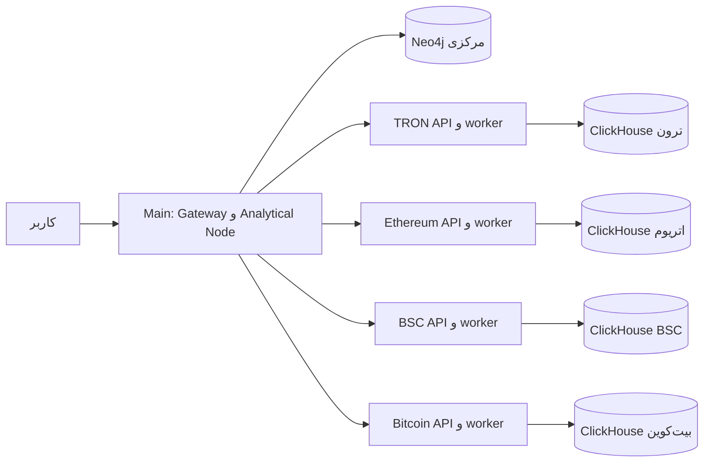

# معماری بک‌اند چهار شبکه

مرجع وضعیت و کارهای باز: [PROJECT_STATUS](PROJECT_STATUS_FA.md) و
[TODO_LIST](../TODO_LIST.md). اجرای واقعی روی VMها هنوز پذیرفته نشده است.

## تقسیم مسئولیت

هر chain VM تنظیمات اتصال به RPC آماده، ingestor، API، worker و ClickHouse
خودش را دارد. Main
به APIها درخواست می‌دهد و مستقیم از ClickHouseهای آن‌ها query نمی‌گیرد.
Neo4j روی Main snapshot تحقیق و گراف قابل بازگشایی را نگه می‌دارد.

یکسان‌سازی ClickHouse یعنی یک منبع DDL و مدل مشترک برای جدول‌ها، ستون‌ها،
واحدها، کلیدها و viewها. دیتابیس یا VM مشترک مرکزی ساخته نمی‌شود.
`shared/warehouse` همین کتابخانهٔ Rust است. هویت شبکه و نام database از
تنظیمات deployment می‌آیند؛ ساختار منطقی مشترک می‌ماند.

مرز HTTP چهار adapter از کتابخانهٔ `shared/chain_api` استفاده می‌کند:
query/path نامعتبر را به JSON نسخه‌دار تبدیل می‌کند و code و status ثابت
به خطاها می‌دهد. این کد داخل همان پردازش API هر VM اجرا می‌شود. منطق مبلغ،
UTXO، receipt و موجودی همچنان در adapter مربوط است و ClickHouseها مستقل‌اند.

همین کتابخانه پاسخ `investigation` و `paths` را با قرارداد افزایشی
`chain_response_v1` یکدست می‌کند: گراف typed در ریشه و بخش‌های مشترک
activity/holdings/paths/attribution در `evidence`. مبلغ و token ID رشتهٔ
صحیح باقی می‌مانند؛ فیلدهای بومی و receiptهای immutable بیت‌کوین جایگزین
نمی‌شوند. مرکز نسخه و سازگاری این نمایش را با شواهد بومی کنترل می‌کند؛
payload کامل به‌همراه گراف قابل query در Neo4j ذخیره می‌شود.

مدل holdings صریح است: UTXO ثبت‌شده، خالص جریان ثبت‌شدهٔ ترون یا state
نهایی‌شدهٔ RPC برای EVM. capability فقط کاربردپذیری را بیان می‌کند و
coverage واقعی جداست. مسیرهای BSC و ترون نیز snapshot منبع دارند.
در اتریوم/BSC یک fingerprint از آخرین ردیف‌های عملیاتی موجود و در ترون
frame عملیاتی خودش کنار canonical snapshot کنترل می‌شود؛ بیت‌کوین receiptهای
مقید به شواهد خودش را دارد. تغییر منبع در بازگشایی/Export، شواهد تاریخی
را حفظ و مصرف ریسک جاری را غیرفعال می‌کند. این قابلیت جدول، سرویس یا
ClickHouse مرکزی تازه‌ای اضافه نمی‌کند؛ schema نسخهٔ ۶ ثابت است.

## دریافت و انتشار

Ingestor بلاک و دادهٔ پشتیبان را از نود می‌گیرد، هویت شبکه، ارتفاع، hash،
ترتیب و وضعیت اجرا را کنترل و facts را به storage می‌دهد. facts نیمه‌تمام
نباید در reader جاری دیده شوند. پس از تکمیل و کنترل شمارش/مبلغ، marker و
checkpoint منتشر می‌شوند. revision و hash امکان retry و تشخیص fork را
می‌دهند؛ reorg باید خروجی وابستهٔ قبلی را از حالت current خارج کند.

Bitcoin/BSC شاخه را با ancestor و rollback مشترک بازیابی می‌کنند. اتریوم
دادهٔ finalized و ترون دادهٔ solid را دریافت می‌کنند؛ تعارض هش این داده‌ها
باعث توقف و حفظ checkpoint می‌شود. در این دو شبکه checkpoint هنگام restart
و poll بدون بلاک جدید هم با RPC تطبیق داده می‌شود؛ دادهٔ نهایی‌شده به‌طور
ضمنی جایگزین نمی‌شود.

هر چهار شبکه این قرارداد را در مسیر دریافت و مصرف داده استفاده می‌کنند.
metadata/intelligence و نتایج مشتق‌شدهٔ ترون نیز مشترک‌اند؛ فایل‌ها و mountهای
DDL قدیمی حذف شده‌اند. هر چهار شبکه schema job دارند و یک بستهٔ SQL
تولیدشده در `shared/warehouse/sql` مرجع بازبینی هر شش فاز است. در اتریوم، withdrawal در
شاهد بلاک و پاسخ `block_credits` با tx hash تهی نمایش داده می‌شود.

## تفاوت‌های شبکه

- Bitcoin مدل UTXO دارد: input، output، outpoint، script و prevout. یک
  تراکنش چندورودی به «یک فرستندهٔ قطعی» یا تمام ترکیب‌های input/output
  تبدیل نمی‌شود. مبلغ صحیح ساتوشی است.
- Ethereum/BSC مدل account، log، token ID و trace دارند. native transfer،
  token transfer، internal flow و withdrawal بلاک‌محور یک منشأ واحد ندارند.
- TRON قرارداد protobuf، TRX/TRC10/TRC20/NFT، receipt/internal و هزینه‌های
  energy/bandwidth دارد. tx/contract/log index باید اصلی و قابل بررسی بماند.

schema تخصص‌ها را با fact مناسب و capability پوشش می‌دهد. جدول نامرتبط
برای یک شبکه خالی می‌ماند؛ مقدار یا شاهد فرضی ساخته نمی‌شود. مبلغ خام
UInt256/ساتوشی با float ذخیره یا جابه‌جا نمی‌شود؛ metadata نمایشی مستقل است.

## تحلیل و تحقیق

منابع و claim/review، entity، خوشه‌بندی، exposure، الگوهای رفتاری و policy
ریسک در سطح‌های مختلف موجودند. detector و heuristic فقط طبق شواهد و پوشش
خود نتیجه می‌دهند. امتیاز ریسک توضیح‌پذیر است؛ `UNKNOWN` معادل بی‌خطر نیست.
خبره‌سازی attribution، دیتاست واقعی و یکسان‌سازی رفتار چهار شبکه باقی است.

کاربر شبکه و آدرس را انتخاب می‌کند. مرکز دادهٔ شبکه را می‌گیرد، شواهد را
بررسی و snapshot موقت می‌سازد. Export همان snapshot را ماندگار می‌کند؛
تغییر source نتیجهٔ قبلی را بی‌صدا تازه نمی‌کند. این قابلیت هنوز workflow
کامل KYT، alert یا پروندهٔ تیمی نیست؛ آن‌ها در برنامهٔ محصول قرار دارند.

دیتابیس تولید از صفر ساخته می‌شود. import تاریخچهٔ دیتابیس قدیمی حذف شده؛
گرفتن بلاک‌های تاریخی از RPC در ingestor اصلی حفظ می‌شود. راهنماها:
[schema](warehouse/README_FA.md)، [VM](VM_SETUP_FA.md)، [استفاده](USAGE_FA.md).
