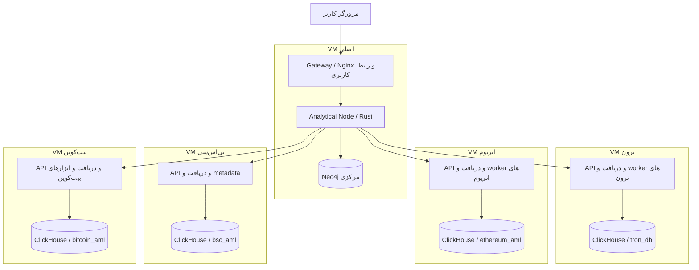

# توضیح بک‌اند، معماری و دیتابیس سامانه AML

تاریخ بررسی: **۲۰۲۶-۱۰-۲۸** — مطابق کد فعلی مخزن، پس از تکمیل AML-05 بیت‌کوین.

این سند توضیح می‌دهد داده از کجا وارد می‌شود، هر سرویس چه کاری انجام می‌دهد،
اطلاعات کجا ذخیره می‌شوند و نتیجهٔ تحقیق چگونه به کاربر می‌رسد. وضعیت زیر، شرح
پیاده‌سازی موجود است؛ اجرای کامل روی VMهای مقصد و پذیرش دادهٔ واقعی همچنان کار جداگانه‌ای است.

## ۱. بک‌اند چه کاری انجام می‌دهد؟

سامانه برای تحقیق دربارهٔ آدرس‌های بلاک‌چین در چهار شبکهٔ **TRON، Ethereum، BSC
و Bitcoin** ساخته شده است. ورودی معمول، نام شبکه و آدرس مورد بررسی است؛ خروجی،
شواهد فعالیت آن آدرس و ارزیابی قابل توضیح بر اساس شواهد موجود است.

بک‌اند چند مسئولیت متصل به هم دارد:

1. بلاک و تراکنش را از نود یا RPC همان شبکه دریافت می‌کند.
2. دادهٔ شبکه را به مدل قابل جست‌وجو تبدیل و در ClickHouse همان شبکه ذخیره می‌کند.
3. تراکنش‌ها، ارتباط‌ها، موجودی مشاهده‌شده و پوشش تاریخچه را برای تحقیق بازیابی می‌کند.
4. برچسب‌های هویتی و ریسک را با منبع و وضعیت review نگه می‌دارد.
5. در مسیرهای پیاده‌شده، ارتباط مستقیم یا چندمرحله‌ای با آدرس‌های پرریسک را بررسی می‌کند.
6. شواهد را به سیاست ریسک مرکزی می‌دهد تا دلیل و سهم هر سیگنال مشخص باشد.
7. نتیجه و گراف همان تحقیق را به‌صورت snapshot در Neo4j مرکزی ذخیره می‌کند.

«داده‌ای دربارهٔ آدرس پیدا نشد» لزوماً به معنی سالم‌بودن آن نیست. ممکن است تاریخچه
هنوز دریافت نشده باشد، منبع برچسب موجود نباشد یا جست‌وجو به محدودیت منابع رسیده باشد.
پاسخ API باید همراه با coverage، وضعیت تازگی و محدودیت‌ها خوانده شود.

## ۲. معماری پنج VM

چهار VM شبکه مستقل‌اند؛ VM اصلی، نقطهٔ ورود کاربر و محل ارزیابی و نگهداری تحقیق‌هاست.
نمودار زیر مسیر اصلی **تحقیق آدرس** را نشان می‌دهد:



| محل | مسئولیت | درگاه API پیش‌فرض |
|---|---|---|
| VM اصلی | Gateway، ارزیابی ریسک، snapshot تحقیق، Neo4j | Gateway: `8080`؛ Analytical Node داخل شبکهٔ Docker: `7001` |
| VM ترون | API، ingestion، metadata و تحلیل‌های موجود ترون | `4001` |
| VM اتریوم | API، ingestion، metadata و تحلیل‌های موجود اتریوم | `5001` |
| VM BSC | API، ingestion، metadata و exposure هنگام درخواست | `6001` |
| VM بیت‌کوین | API، ingestion، UTXO، intelligence و exposure هنگام درخواست | `6101` |

هر VM شبکه از RPC مربوط به خودش استفاده می‌کند. محل نود با تنظیمات اتصال مشخص
می‌شود و می‌تواند خارج از VM برنامه باشد؛ وجود API این پروژه به‌خودی‌خود به معنی
نصب یا همگام‌بودن یک full node نیست.

مدیریت مرکزی در مسیر تحقیق یعنی انتخاب API شبکه، دریافت شواهد، ارزیابی مشترک و
ذخیرهٔ نتیجه. دریافت مستمر بلاک روی VM هر شبکه اجرا می‌شود. ساخت VM و روشن‌کردن
سرویس‌های نقش‌ها را اسکریپت‌های استقرار و Docker Compose انجام می‌دهند؛ Analytical
Node یک کنترل‌کنندهٔ عمومی hypervisor یا صف مرکزی تمام jobهای شبکه‌ها نیست.

## ۳. نقش اجزای بک‌اند

| جزء | کار اصلی |
|---|---|
| Gateway | ارائهٔ صفحات، مسیریابی درخواست، افزودن service key، محدودیت نرخ و ارسال تحقیق‌ها به مرکز |
| API شبکه | اعتبارسنجی آدرس و پارامترها، خواندن شواهد و ساخت پاسخ مخصوص همان شبکه |
| Ingestion | دریافت بلاک، استخراج داده، پیشروی checkpoint و رسیدگی به خطا یا تغییر شاخه |
| Worker | اجرای دوره‌ای کارهایی مانند metadata و تحلیل، فقط در شبکه‌هایی که worker آن پیاده و فعال شده است |
| ابزارهای CLI | کارهای عملیاتی صریح مانند schema، probe، import، review و repair؛ قابلیت‌ها در هر شبکه متفاوت‌اند |
| Analytical Node | دریافت پاسخ شبکه، کنترل هویت و تازگی، اجرای سیاست ریسک و مدیریت تحقیق‌های مرکزی |
| ClickHouse | نگهداری و جست‌وجوی حجم بالای دادهٔ بلاک‌چین و نتایج تحلیلی همان شبکه |
| Neo4j | نگهداری گراف و payload کامل snapshot هر تحقیق در VM اصلی |
| `shared/warehouse` | کتابخانهٔ Rust و قرارداد مشترک schema، migration، اعتبارسنجی و خواندن/انتشار داده |

`shared/warehouse` نام یک **بستهٔ کد مشترک** است. سرویس ClickHouse اضافه یا database
مرکزی ایجاد نمی‌کند. هر adapter این کتابخانه را در برنامهٔ خودش مصرف می‌کند.

## ۴. دو جریان اصلی داده

### دریافت دادهٔ زنجیره

```text
Node / RPC
    → دریافت بلاک و resolve داده‌های وابسته
    → استخراج تراکنش، ارتباط، ورودی/خروجی و شواهد
    → کنترل مقدار، هویت شبکه و ترتیب بلاک
    → درج داده در ClickHouse همان VM
    → کنترل تکمیل داده
    → انتشار checkpoint قابل خواندن
```

در بیت‌کوین، resolve یعنی پیدا کردن output قبلیِ خرج‌شده توسط هر input. بدون
اطلاعات معتبر آن output، مقدار و subject ورودی حدس زده نمی‌شود. retry/backoff،
fallback کنترل‌شده، failure/dead-letter و repair محدود پیاده شده‌اند. دریافت،
checkpoint و قفل writer مشترک همان VM دارند؛ این قفل، lease توزیع‌شده میان چند میزبان نیست.

### تحقیق یک آدرس

1. کاربر شبکه و آدرس را در صفحهٔ اصلی انتخاب می‌کند.
2. Gateway درخواست investigation را به Analytical Node می‌فرستد.
3. مرکز، API همان شبکه را با service key صدا می‌زند.
4. API از دادهٔ ذخیره‌شده، گراف و اطلاعات تحقیق را می‌سازد. در بیت‌کوین، برچسب‌ها
   خوانده و exposure محدود نیز همان‌جا محاسبه و در ClickHouse ثبت می‌شود.
5. مرکز شواهد را ارزیابی و وضعیت source، برچسب و runهای وابسته را بررسی می‌کند.
6. payload کامل و گراف نرمال‌شده به‌صورت تحقیق موقت در Neo4j ثبت می‌شوند.
7. پاسخ شامل شناسهٔ تحقیق، ریسک، دلایل، گراف و coverage به مرورگر می‌رسد.

Gateway همهٔ endpointها را به مرکز نمی‌فرستد: investigation، paths و مدیریت
تحقیق‌ها از مرکز عبور می‌کنند؛ APIهای دیگر مانند holdings یا خواندن exposure به
API شبکهٔ مربوط هدایت می‌شوند. فراخوانی مستقیم API شبکه، به‌تنهایی snapshot مرکزی ایجاد نمی‌کند.

## ۵. مرز ClickHouse و Neo4j

| موضوع | ClickHouse هر شبکه | Neo4j مرکزی |
|---|---|---|
| دادهٔ اصلی | بلاک، تراکنش، ارتباط، شواهد تخصصی و خروجی تحلیل | snapshot نتیجه و گراف هر تحقیق |
| محل | VM همان شبکه | فقط VM اصلی |
| مقیاس منطقی | تاریخچهٔ دریافت‌شدهٔ شبکه | زیرمجموعهٔ مورد استفاده در تحقیق‌ها |
| مدل داده | جدول‌های ستونی و viewهای کنترل‌شده | گره، یال و payload JSON |
| نقش در بازکردن تحقیق قبلی | بررسی تازگی منبع و شواهد وابسته | بازگرداندن snapshot ذخیره‌شده |

اطلاعات تمام زنجیره‌ها برای هر تحقیق به Neo4j کپی نمی‌شود. همچنین مرکز برای
مسیر معمول تحقیق مستقیماً به ClickHouseهای چهار VM وصل نمی‌شود؛ مرز ارتباط، API شبکه‌هاست.

**ساختار یکسان دیتابیس** در این پروژه یعنی تعریف مشترک نام جدول، ستون، نوع، کلید،
engine، view و migration. داده‌ها، نام database، رمز اتصال و volume هر شبکه مستقل‌اند.
چهار ClickHouse مجزا می‌توانند یک schema مشترک داشته باشند.

## ۶. ساختار مشترک ClickHouse

قرارداد مؤثر فعلی **نسخهٔ ۵** است و **۳۹ جدول، ۵۳ view و ۶۸۲ ستون فیزیکی جدول**
تعریف می‌کند. این تعداد مربوط به قرارداد مشترک است؛ در سه شبکهٔ قدیمی، جدول‌های
legacy نیز وجود دارند و تعداد کل اشیای دیتابیس الزاماً همین عدد نیست.

منبع تعریف قرارداد فایل‌های نسخه‌دار در `shared/warehouse/schema/` است. خروجی
قابل مطالعهٔ تمام ستون‌ها، کلیدها و viewها در [قرارداد جاری](warehouse/current-contract.json)
قرار دارد. SQL نصب بیت‌کوین در `dockerizd_bitcoin/sql/migrations/` از همین قرارداد
تولید و هنگام نصب با منبع مشترک تطبیق داده می‌شود.

### خانوادهٔ جدول‌ها

در جدول زیر، «وجود در قرارداد» به معنی فعال‌بودن writer و قابلیت تحلیلی آن در
بیت‌کوین نیست. وضعیت اجرایی بعد از جدول توضیح داده شده است.

| خانواده | جدول | چه چیزی نگه می‌دارد؟ |
|---|---|---|
| schema | `aml_schema_migrations` | migrationهای اعمال‌شده، checksum و revision |
| schema | `aml_warehouse_identity` | هویت شبکه و نسخهٔ ساختار همان database |
| دریافت | `aml_sync_state` | محدودهٔ دریافت و آخرین checkpoint منتشرشده |
| دریافت | `aml_ingested_blocks` | بلاک، hash، وضعیت دریافت و شمارش مورد انتظار داده‌ها |
| دریافت | `aml_ingestion_failures` | خطا، تلاش مجدد و وضعیت رسیدگی |
| دریافت | `aml_ingestion_benchmarks` | نتیجهٔ سنجش دریافت؛ ابزار بیت‌کوین هنوز تکمیل نشده است |
| دادهٔ پایه | `aml_transactions` | اطلاعات عمومی تراکنش و شواهد منبع |
| دادهٔ پایه | `aml_address_relationships` | ارتباط نوع‌دار میان subjectها و شواهد انتقال |
| تحلیل | `aml_transaction_features` | ویژگی‌های استخراج‌شده از تراکنش |
| تحلیل | `aml_semantic_aml_events` | رویداد تحلیلی همراه روش، نسخه و شواهد |
| metadata | `aml_asset_metadata` | اطلاعات دارایی مانند symbol، decimals و provenance |
| metadata | `aml_metadata_jobs` | وضعیت کارهای دریافت metadata |
| metadata | `aml_metadata_discoveries` | شواهد کشف دارایی از دادهٔ زنجیره |
| intelligence | `aml_intelligence_sources` | منبع ادعا، اطلاعات اعتماد و وضعیت فعالیت |
| intelligence | `aml_intelligence_claims` | ادعای انتساب یا ریسک با شواهد و بازهٔ اعتبار |
| intelligence | `aml_intelligence_reviews` | تصمیم review و snapshot شواهد همان تصمیم |
| registry | `aml_protocol_registry` | اطلاعات مستند پروتکل و سرویس |
| entity | `aml_entities` | کاتالوگ موجودیت‌ها |
| entity | `aml_entity_addresses` | ارتباط مستند موجودیت و آدرس |
| clustering | `aml_cluster_claims` | ادعای رابطه یا کاندیدای عضویت |
| clustering | `aml_cluster_memberships` | عضویت subject در نسخهٔ خوشه |
| clustering | `aml_cluster_runs` | مشخصات و وضعیت اجرای خوشه‌بندی |
| clustering | `aml_cluster_versions` | نسخه و مشخصات خوشه |
| exposure | `aml_exposure_seeds` | snapshot seed و claim مبنای محاسبه |
| exposure | `aml_exposure_runs` | اجرای تحلیل، تنظیمات، محدوده و وابستگی‌ها |
| exposure | `aml_exposure_paths` | مسیر، جهت، hop، مبلغ و شواهد |
| exposure | `aml_address_exposures` | خلاصهٔ مواجههٔ آدرس؛ در بیت‌کوین قوی‌ترین مسیر هر seed/direction |
| risk | `aml_risk_policies` | تعریف نسخهٔ سیاست ریسک |
| risk | `aml_risk_policy_rules` | قواعد همان نسخهٔ سیاست |
| risk | `aml_wallet_risk_signals` | سیگنال‌ها و سهم آن‌ها در assessment |
| risk | `aml_wallet_risk_assessments` | نتیجهٔ ساختاریافتهٔ ارزیابی |
| Bitcoin | `aml_bitcoin_inputs` | input، مقدار ساتوشی و ارجاع به output قبلی |
| Bitcoin | `aml_bitcoin_outputs` | output، آدرس یا script و مقدار ساتوشی |
| Bitcoin | `aml_bitcoin_scripts` | شواهد تخصصی script |
| EVM | `aml_evm_logs` | log و شواهد رویداد EVM |
| EVM | `aml_evm_traces` | trace و شواهد اجرای داخلی |
| TRON | `aml_tron_contracts` | دادهٔ تخصصی contractهای ترون |
| دادهٔ منبع | `aml_raw_transactions` | envelope خام تراکنش و provenance |
| انتشار تحلیل | `aml_analysis_publications` | تأیید انتشار کامل خروجی وابسته به یک snapshot منبع |

دادهٔ پایه، failure، intelligence، exposure و کاندیداهای خوشه‌بندی بیت‌کوین مسیر فعال روی قرارداد مشترک
دارند. جدول‌های مخصوص EVM یا TRON در schema بیت‌کوین هم تعریف می‌شوند، اما دادهٔ
ساختگی برای قابلیت نامرتبط تولید نمی‌شود. چهار جدول clustering برای run، claim،
membership کاندیدا و نسخه/بازبینی مصرف می‌شوند؛ خوشهٔ مالکیت قطعی ساخته نمی‌شود. چهار جدول
خانوادهٔ risk نیز اکنون writer/reader فعال برای سیاست و ارزیابی بیت‌کوین دارند.
برای نمونه، نمایش entities بیت‌کوین اکنون از claimهای معتبر ساخته می‌شود؛ نباید از
وجود جدول `aml_entities` نتیجه گرفت که کاتالوگ مستقل آن نیز کاملاً پر شده است.

### ستون‌ها و کلیدهای مهم

| فیلد | معنی و کاربرد |
|---|---|
| `network_id` | هویت شبکه؛ در scope جست‌وجو و کلیدهای مشترک حضور دارد |
| `block_number`، `block_hash` | ارتفاع و هویت بلاک؛ ارتفاع به‌تنهایی برای تشخیص شاخه کافی نیست |
| `block_timestamp_unix_ms` | زمان بلاک به میلی‌ثانیهٔ UTC |
| `commit_id` | تلاش دریافت و ثبت همان بلاک |
| `revision` | نسخهٔ صحیح رکورد یا انتشار؛ برای انتخاب وضعیت معتبر استفاده می‌شود |
| `tx_hash` و `transaction_index` | هویت تراکنش و موقعیت آن در بلاک |
| `subject_id` / `subject_type` | شناسه و نوع موجودیت در گراف؛ آدرس، تراکنش یا script |
| `asset_id`، `amount_raw`، `decimals` | دارایی، مبلغ در کوچک‌ترین واحد و تعداد اعشار نمایش |
| `source_id`، `evidence_refs` | منشأ ادعا و ارجاع‌های قابل بررسی |
| `run_id`، `assessment_id` | اتصال نتیجه به اجرای تحلیل یا ارزیابی مشخص |

بسته به خانوادهٔ جدول، همهٔ این فیلدها لزوماً هم‌زمان وجود ندارند. ارتباط جدول‌ها
با این شناسه‌ها، joinها و اعتبارسنجی برنامه برقرار می‌شود؛ این schema مدل روابط
منطقی دارد، اما مجموعه‌ای از foreign keyهای تضمین‌شده مثل یک دیتابیس تراکنشی رابطه‌ای نیست.

مبلغ عمومی قرارداد از integerهایی مانند `UInt256` استفاده می‌کند. مقدار native
ورودی/خروجی بیت‌کوین `UInt64` و بر حسب ساتوشی است. برای انتقال مقادیر بزرگ و revision
در JSON از رشتهٔ عددی دقیق استفاده می‌شود. float برای نسبت، confidence و امتیاز
استفاده می‌شود؛ مبلغ اصلی بیت‌کوین با float جمع و تفریق نمی‌شود. `NULL` هم به معنی
«صفر» نیست؛ مثلاً تراکنش چندورودی بیت‌کوین یک `from_address` یکتا ندارد.

### engine، partition و index

جدول‌های قرارداد فعلی از `ReplacingMergeTree(revision)` استفاده می‌کنند. رکورد
جدید می‌تواند وضعیت قبلی همان کلید را جایگزین منطقی کند؛ ادغام فیزیکی ممکن است
بعداً انجام شود. بنابراین نباید صرفاً با خواندن جدول خام، یکتایی یا آخرین وضعیت را فرض کرد.

جدول‌های fact معمولاً بر اساس بازه‌های **۱۰۰ هزار بلاکی** partition می‌شوند؛
کلید مرتب‌سازی آن‌ها شامل شبکه، بلاک، hash، commit و شناسهٔ fact است. جدول‌های
وضعیت یا کاتالوگ کلیدهایی مانند شبکه و `source_id` یا `run_id` دارند. indexهایی
مانند bloom filter روی `tx_hash` یا subject به محدودکردن خواندن کمک می‌کنند؛
تعریف دقیق هر جدول در قرارداد جاری آمده است.

## ۷. چرا view، checkpoint و seal لازم‌اند؟

درج دادهٔ چند جدول در ClickHouse یک transaction اتمیک سراسری ایجاد نمی‌کند.
ممکن است فرایند بعد از درج بخشی از داده متوقف شود. قرارداد مشترک برای جلوگیری
از نمایش چنین داده‌ای، انتشار را از درج فیزیکی جدا کرده است.

در مسیر بیت‌کوین، ابتدا داده‌ها درج و کنترل می‌شوند، سپس کامل‌بودن بلاک ثبت و در
آخر checkpoint منتشر می‌شود. reader دادهٔ قابل انتشار را از view می‌گیرد. در
reorg نیز factهای قدیمی فوری پاک نمی‌شوند؛ نشانگرهای orphan و revision جدید،
شاخهٔ معتبر را مشخص می‌کنند.

| پسوند view | برداشت درست |
|---|---|
| `_canonical` | factهای منطبق با بلاک و checkpoint منتشرشدهٔ معتبر |
| `_current` | آخرین وضعیت ذخیره‌شدهٔ آن خانواده؛ لزوماً تحلیل تازه و قابل امتیازدهی نیست |
| `_active` | projection با شروط فعالیت و شواهد مربوط؛ شروط دقیق با خانواده فرق دارد |
| `_visible` | خروجی تحلیلی منطبق با parent و seal معتبر و snapshot منبع |

seal در `aml_analysis_publications` یعنی تعداد و revision خروجی‌های یک run کامل
کنترل و وابستگی آن به snapshot منبع ثبت شده است. خروجی ناقص یا بدون seal ورودی
ریسک جاری نمی‌شود. این راهکار جایگزین transaction توزیع‌شده نیست؛ readerها تغییر
revision میان خواندن‌ها را نیز کنترل می‌کنند.

برای exposure بیت‌کوین، seal به‌تنهایی کافی نیست: reader `exposure::inspect`
وابستگی claim، review و source را هم دوباره بررسی می‌کند. حتی آدرسی که هنگام
محاسبه برچسب نداشته، dependency است؛ تأیید برچسب جدید در آن می‌تواند نتیجهٔ قبلی
را قدیمی کند. تغییر checkpoint، حتی با اضافه‌شدن عادی بلاک، فعلاً نتیجهٔ وابسته
به snapshot قبلی را از مصرف جاری خارج می‌کند و محاسبهٔ تازه لازم است.

## ۸. تفاوت مدل بیت‌کوین با سه شبکهٔ دیگر

در مدل account-based، انتقال مشاهده‌شده معمولاً میان دو آدرس بیان می‌شود. در
بیت‌کوین، یک تراکنش چند input و چند output دارد و نباید یک فرستنده/گیرندهٔ
مصنوعی برای کل آن ساخته شود. مدل گراف آن چنین است:

```text
آدرس یا script خروجی قبلی → تراکنش فعلی → آدرس یا script خروجی جدید
          utxo_input                      utxo_output
```

هر input با `prev_tx_hash` و `prev_output_index` به outpoint قبلی وصل می‌شود.
occurrence بلاک و ترتیب تراکنش نیز مهم‌اند؛ صرف تکرار یک آدرس یا hash برای ساخت
مسیر کافی نیست. script بدون آدرس، همان subject نوع script باقی می‌ماند.

موجودی بیت‌کوین از outputهای خرج‌نشده در **محدودهٔ بلاک‌های دریافت‌شده** محاسبه
می‌شود؛ output خرج‌شده از آن کنار می‌رود. پاسخ، ارتفاع snapshot، کامل‌بودن تاریخچه
و مقدار coinbase نابالغ را نیز مشخص می‌کند. این مسیر mempool را شامل نمی‌شود و
اگر تاریخچه ناقص باشد، موجودی مشاهده‌شده تضمین موجودی کامل آدرس نیست.

fingerprint اکنون مقدار دریافت/خرج و net flow، تعداد leg و occurrence تراکنش،
کارمزد تراکنش‌های مرتبط، زمان و شکل تراکنش را گزارش می‌کند. فعالیت روزانه UTC و
طرف‌های مقابلِ context تراکنش نیز در پنل هستند. فیلتر ارتفاع/زمان/جهت فقط analytics
را محدود می‌کند؛ graph، holdings، exposure و ریسک scope خودشان را حفظ می‌کنند.
کارمزد به‌طور خودکار به آدرس نسبت داده نمی‌شود و peerهای تراکنش، پرداخت قطعی
آدرس به آدرس نیستند. [شرح آمار، فیلتر و سقف منابع](../dockerizd_bitcoin/ACTIVITY.md).

### intelligence و exposure بیت‌کوین

مسیر برچسب چنین است: **ثبت source → import به‌صورت pending → review مستقل →
خواندن claim معتبر در تحقیق**. منبع، evidence، revision تصمیم و بازهٔ اعتبار
بررسی می‌شوند. import خودکار تأیید نمی‌شود و دادهٔ واقعی برچسب باید توسط اپراتور تهیه و بررسی شود.

seed یک آدرس با claim معتبر و designation صریح ریسک است که مبنای exposure قرار
می‌گیرد. exposure فعلیِ بیت‌کوین ورودی/خروجی و چندمرحله‌ای است و فقط outpoint
واقعاً خرج‌شده را دنبال می‌کند. برای سهم مقدار، بازهٔ محافظه‌کارانهٔ حد پایین و
حد بالا می‌سازد؛ تخصیص دقیق ساتوشی یا مالکیت مشترک را ادعا نمی‌کند.

مثلاً اگر تنها ورودی یک تراکنش، ۱۰۰ ساتوشی از seed باشد و outputها ۶۰ و ۳۹ و
کارمزد ۱ ساتوشی باشند، output اول در این مدل بازهٔ `[60,60]` دارد. اگر ورودی‌ها
۱۰۰ ساتوشی از seed و ۱۰۰ ساتوشی دیگر باشند، output هدفِ ۹۹ ساتوشی می‌تواند بازهٔ
`[0,99]` داشته باشد؛ حد پایین صفر است و این مسیر فقط context باقی می‌ماند.

مسیر دارای حد پایین مثبت، با confidence، ریسک seed و کاهش وزن بر اثر فاصله و
زمان بررسی می‌شود. مرز سرویس شناخته‌شده مانند صرافی traversal را متوقف می‌کند.
مسیرها ممکن است هم‌پوشان باشند؛ جمع مبلغ یا رأی مستقل برای مسیرهای تکراری انجام
نمی‌شود. پیش‌فرض exposure سه hop، صد تراکنش و پنجاه مسیر است؛ یک hop، یک تراکنش است.
سقف‌ها و truncation در پاسخ اعلام می‌شوند.

جزئیات روش و فرمان‌ها: [intelligence](../dockerizd_bitcoin/INTELLIGENCE.md) و
[exposure](../dockerizd_bitcoin/EXPOSURE.md).

## ۹. ارزیابی ریسک مرکزی

سیاست فعلی در کتابخانهٔ `shared/risk_policy` با نسخهٔ
`aml_evidence_v2_verified_inputs` اجرا می‌شود. مسیر اصلی از قواعد و شواهد استفاده
می‌کند؛ ML فعال نیست. خروجی شامل `risk_score`، سطح ریسک، `policy_version`، signal،
contribution، شواهد و محدودیت‌هاست. مرکز و adapter بیت‌کوین همین کد را مصرف می‌کنند؛
فایل `analytical_node/src/risk.rs` مسیر سازگاری مصرف مرکزی را نگه می‌دارد.

| شاهد پذیرفته‌شده | سقف سهم در سیاست موجود |
|---|---|
| برچسب پرریسک فعال و تأییدشده | ۷۰، متناسب با درجهٔ ریسک ثبت‌شده |
| مواجههٔ ورودی مستقیم با seed | ۵۵ × قدرت exposure |
| مواجههٔ خروجی مستقیم با seed | ۴۵ × قدرت exposure |
| مواجههٔ چندمرحله‌ای | ۲۵ × قدرت exposure |
| رویداد mixer با شواهد معتبر و confidence لازم | ۱۵، فقط در مسیرهای دارای detector و provenance معتبر |
| الگوی ارسال سریعِ هم‌دارایی با شروط کد | ۵؛ به legهای UTXO بیت‌کوین تحمیل نمی‌شود |

فقط قوی‌ترین exposure سهم می‌گیرد. جمع سیگنال‌ها حداکثر ۱۰۰ است: از ۶۰ به بالا
HIGH، از ۲۵ تا کمتر از ۶۰ MEDIUM و مقدار مثبت کمتر از ۲۵ LOW است. بدون شواهد کافی
خروجی UNKNOWN و امتیاز `null` می‌شود. بیت‌کوین بدون سیگنال معتبر، با زیادبودن
تعداد تراکنش‌ها به‌تنهایی از UNKNOWN خارج نمی‌شود. در برخی مسیرهای account-based،
دادهٔ کافی بدون سیگنال به NO_SIGNALS می‌رسد؛ این هم ادعای سالم‌بودن قطعی نیست.

این امتیاز، نمرهٔ شواهد سیاست پروژه است؛ احتمال آماری یا اثبات پول‌شویی نیست.
وجود یک قاعده در سیاست به معنی پیاده‌بودن detector آن برای همهٔ شبکه‌ها نیست.
مرکز برای exposure بیت‌کوین، scope، seed، snapshot و شواهد مقدار/outpoint را نیز کنترل می‌کند.

**وضعیت ذخیره‌سازی ریسک:** policy و rules و assessment و signals بیت‌کوین در
چهار جدول مشترک ClickHouse همان VM ذخیره و با ID بازیابی می‌شوند. مرکز نتیجه را
با همان سیاست دوباره محاسبه، snapshot ارزیابی را کنترل و در payload تحقیقِ Neo4j
حفظ می‌کند. این مسیر در AML-04 تکمیل شده است؛ تغییر وزن در دیتابیس سیاست اجرایی
را تغییر نمی‌دهد. [جزئیات و مرز اعتبار](../dockerizd_bitcoin/RISK.md).

## ۱۰. ساختار Neo4j و عمر تحقیق

مدل فعلی مرکز:

```text
(Investigation)-[:CONTAINS]->(InvestigationWallet)
(InvestigationWallet)-[:TRANSFER]->(InvestigationWallet)
```

`Investigation` شناسه، شبکه، آدرس، owner، زمان، حالت temporary/saved، hash snapshot
و `payload_json` را نگه می‌دارد. payload شامل پاسخ تحقیق و ارزیابی ریسک است.

`InvestigationWallet` نام تاریخی label گره‌های گراف است؛ در بیت‌کوین می‌تواند
subject نوع address، transaction یا script را نمایندگی کند. نام label به معنی
این نیست که همهٔ گره‌ها آدرس کیف پول یا تحت مالکیت یک شخص هستند. یال `TRANSFER`
نیز نوع و شواهد اصلی ارتباط را حفظ می‌کند؛ legهای UTXO به انتقال قطعی آدرس به آدرس تبدیل نمی‌شوند.

گره‌ها به شناسهٔ همان تحقیق scope می‌شوند؛ بازدیدهای مختلف از یک آدرس، خودکار
یک گراف سراسریِ هویت اشخاص ایجاد نمی‌کنند. قید یکتایی شناسهٔ تحقیق و کلید گره،
و indexهای owner و expiry در راه‌اندازی مرکز ایجاد می‌شوند.

تحقیق ابتدا **موقت** است و به‌طور پیش‌فرض ۲۴ ساعت عمر دارد؛ مقدار قابل تنظیم
۱ تا ۱۶۸ ساعت است. Export همان snapshot را با وضعیت saved نگه می‌دارد و انقضا
را برمی‌دارد؛ Export به معنی اجرای دوبارهٔ تحقیق یا دانلود خودکار فایل نیست.
پاک‌سازی دوره‌ای، تحقیق‌های موقت منقضی‌شده را از Neo4j حذف می‌کند.

در create، reopen و Export، تازگی شواهد کنترل می‌شود. تغییر زنجیره یا لغو منبع/
برچسب می‌تواند نتیجه را stale کند؛ عدم امکان بررسی، unverified است. شواهد و
ارزیابی قدیمی برای تاریخچه حفظ می‌شوند، اما ریسک جاری قابل استفاده تلقی نمی‌شود
و نیاز به تحقیق تازه دارد. Export نتیجهٔ stale، آن را تازه نمی‌کند.

## ۱۱. ساختار پوشه‌ها و محل دنبال‌کردن کد

```text
compose.yaml                     سرویس‌های VM اصلی
gateway/                         Nginx، صفحات و مسیریابی
analytical_node/src/
  main.rs                        API مرکزی و کنترل freshness
  risk.rs                        سیاست شواهدی ریسک
  store.rs                       خواندن/نوشتن تحقیق در Neo4j
shared/warehouse/
  schema/                        تعریف نسخه‌دار قرارداد مشترک
  src/migration.rs               نصب، ارتقا و اعتبارسنجی
  src/publication.rs             انتشار بلاک و checkpoint
  src/visibility.rs              snapshot و انتشار نتیجهٔ تحلیلی
  src/relationships/             مدل و reader مشترک روابط
shared/risk_policy/              سیاست شواهدی واحد برای مرکز و بیت‌کوین
dockerizd_tron/app/               adapter، SQL و سرویس‌های ترون
dockerizd_ethereum/               adapter، SQL و سرویس‌های اتریوم
dockerizd_bsc/                    adapter، SQL و سرویس‌های BSC
dockerizd_bitcoin/
  src/bitcoin/                   RPC، دریافت، resolve، probe، failure و repair
  src/domain/                    مدل آدرس، script، مبلغ و شواهد
  src/storage/                   writer و قفل آن
  src/db/                        client، migration و query
  src/intelligence/              source، claim، review و CLI
  src/exposure/                  پیمایش outpoint و بازهٔ مبلغ
  src/activity.rs                آمار scoped، روزهای UTC و peerهای تراکنش
  src/risk.rs                    ثبت و بازیابی ارزیابی و کنترل وابستگی‌ها
  src/api.rs                     API تحقیق بیت‌کوین
  src/bin/bitcoin_init_schema.rs  binary نصب/بررسی schema
  sql/migrations/                SQL فعال مشتق از قرارداد مشترک
  sql/legacy/                    SQL قدیمی برای سازگاری/انتقال
  tests/                         تست‌های adapter و ClickHouse
scripts/                         راه‌اندازی، VM، backup، بررسی و انتقال image
contracts/                       قرارداد API میان اجزا
docs/                            مستندات و گزارش‌های آزمون
```

## ۱۲. دسترسی، عملیات و وضعیت واقعی تکمیل

API شبکه‌ها باید از مسیر خصوصی VM اصلی قابل دسترسی باشند؛ پورت دیتابیس‌ها در
Compose به localhost bind می‌شوند. Gateway service key را در هدر
`X-AML-Service-Key` اضافه می‌کند و کلید را به JavaScript مرورگر نمی‌دهد.
ورود Basic Auth در Gateway قابل تنظیم است. مالک تحقیق در مرکز از هویت معتبر
Gateway یا session مرورگر گرفته می‌شود؛ فهرست و بازکردن تحقیق‌ها با owner محدود می‌شوند.
این سازوکار به معنی اضافه‌شدن RBAC سازمانی کامل برای review نیست.

تنظیمات خصوصی در `.env` همان نقش قرار می‌گیرند. روشن‌کردن API، ingestion را
لزوماً شروع نمی‌کند. `/health` معمولاً زنده‌بودن فرایند و `/ready` آمادگی وابستگی
تعریف‌شده را می‌سنجد؛ برای مثال readiness مرکزی Neo4j را می‌سنجد، نه تکمیل
تاریخچهٔ تمام شبکه‌ها. status و coverage باید جدا بررسی شوند.

| موضوع | وضعیت فعلی |
|---|---|
| جداسازی چهار ClickHouse و Neo4j مرکزی | در معماری و Compose تعریف شده است |
| قرارداد مشترک نسخهٔ ۵ و init/check | در هر چهار adapter مصرف می‌شود |
| انتقال کامل سه شبکهٔ قدیمی به جدول‌های مشترک | باز؛ writer/readerهای legacy هنوز فعال‌اند |
| Bitcoin ingestion، UTXO و تحقیق پایه | پیاده و در محدودهٔ گزارش‌ها آزمون شده‌اند |
| Bitcoin source، pending import و review | پیاده و به API/ریسک/پنل وصل شده‌اند |
| Bitcoin exposure مستقیم و چندمرحله‌ای | محدود و هنگام درخواست؛ ذخیره و بررسی freshness فعال است |
| Bitcoin semantic evidence | الگوهای نسخه‌دار با انتشار fact تک‌تراکنشی و محاسبهٔ زنجیرهٔ outpoint هنگام تحقیق؛ بدون امتیاز مستقل |
| Bitcoin clustering | کاندیدای محدود common-input/change با شواهد و review نسخه‌دار؛ بدون مالکیت یا امتیاز ریسک |
| Bitcoin refresh و worker پیوسته | sweep محدود و تکرارشوندهٔ آدرس‌های canonical با صف، cursor پایدار، heartbeat و retry؛ بدون ادعای تازگی کل شبکه |
| Bitcoin ثبت ساختاریافتهٔ risk در ClickHouse | فعال؛ policy/rules و assessment/signals با seal و بررسی reader |
| Bitcoin fingerprint و activity | فعال هنگام درخواست، با فیلتر و پوشش؛ worker و ظرفیت production جدا هستند |
| Bitcoin metadata و holdings | مشخصات ثابت BTC در registry مشترک، وضعیت outpoint با BIP30 و maturity؛ snapshot محاسباتی در تحقیق مرکزی حفظ می‌شود |
| benchmark، replay مستقل و هم‌سطح‌شدن نهایی امکانات | کارهای باز در TODO |
| استقرار نهایی، ظرفیت و پذیرش چهار شبکه با نود واقعی | با آزمون‌های فعلی تأیید نشده‌اند |

تست‌های اخیر exposure، ClickHouse واقعی موقت و شواهد مصنوعی را تا API، سیاست
مرکزی و پنل پوشش داده‌اند؛ بخش ذخیرهٔ Neo4j در پذیرش مرکزی با mock بررسی شده است.
این با تست روی VMهای مقصد و دادهٔ mainnet یکسان نیست. شماره و دامنهٔ دقیق آزمون‌ها
در گزارش‌های زیر ثبت شده‌اند.

## منابع داخل پروژه

- [README و ورود به پروژه](../README.md)
- [فهرست کارهای تکمیل‌شده و باقی‌مانده](../TODO_BITCOIN.md)
- [قرارداد مشترک و وضعیت مهاجرت](../shared/warehouse/README.md)
- [تمام جدول‌ها، ستون‌ها، کلیدها و viewهای نسخهٔ ۵](warehouse/current-contract.json)
- [فرهنگ داده و نگاشت مسیرهای قدیمی](warehouse/data-dictionary.json)
- [انتشار، canonical و visibility](warehouse/DB07_VISIBILITY_FA.md)
- [معماری و راه‌اندازی VMها](MULTI_VM_DEPLOYMENT_FA.md)
- [برچسب و review بیت‌کوین](../dockerizd_bitcoin/INTELLIGENCE.md)
- [روش و محدودیت exposure بیت‌کوین](../dockerizd_bitcoin/EXPOSURE.md)
- [گزارش پذیرش AML-01](../dockerizd_bitcoin/INTELLIGENCE_VALIDATION.md)
- [گزارش پذیرش AML-03](../dockerizd_bitcoin/EXPOSURE_VALIDATION.md)
- [روش و پذیرش AML-04](../dockerizd_bitcoin/RISK.md)
- [روش و پذیرش AML-05](../dockerizd_bitcoin/ACTIVITY.md)
- [backup و restore مستقل هر شبکه](warehouse/DB08A_BACKUP_RESTORE_FA.md)

بعضی راهنماهای قدیمی، وضعیت مرحلهٔ خودشان را شرح می‌دهند. برای نسخهٔ فعلی schema،
قرارداد جاری و برای قابلیت‌های باز، TODO و گزارش پذیرش همان مرحله ملاک‌اند.

## شواهد الگوهای بیت‌کوین — AML-06

الگوهای consolidation، fan-out، CoinJoin احتمالی و peel-step در جدول موجود
`aml_semantic_aml_events` همراه commit خود بلاک ثبت می‌شوند. manifest نسخه و
تعداد تحلیل/skip در `aml_ingested_blocks.raw_evidence_json` قرار دارد. بلاک‌های
قدیمی بازنویسی نمی‌شوند؛ خواندن canonical، شواهد تاریخی و زنجیرهٔ peeling از
outpoint واقعی را هنگام تحقیق می‌سازد. خروجی محاسباتی همراه ورودی ریسک در
ClickHouse همان VM و پاسخ کامل در snapshot مرکزی حفظ می‌شود.

نسخه و hash تعریف detector، منبع، رویدادها و coverage به snapshot و evidence hash
ارزیابی متصل‌اند. مرکز هنگام بازکردن/Export پیکربندی جاری detector را هم کنترل
می‌کند؛ تغییر آن نتیجه را تاریخی و ریسک جاری را UNKNOWN می‌کند.

این الگوها فقط سرنخ تحقیق‌اند: confidence احتمال جرم نیست؛ change، مالکیت مشترک،
mixer یا پول‌شویی را ثابت نمی‌کنند و به‌تنهایی امتیاز ریسک نمی‌سازند. دامنه
حداکثر ۲۵ ریشهٔ اخیر در فیلتر فعالیت است و context می‌تواند بیرون فیلتر برود؛
محدودیت منابع و پوشش ناقص صریح گزارش می‌شوند. schema و جداسازی چهار ClickHouse
تغییر نکرده‌اند. backfill تاریخی و پذیرش واقعی باز هستند؛ worker در AML-08 و کاندیداهای
خوشه‌بندی در مرحلهٔ AML-02 زیر اضافه شده‌اند.
[جزئیات](../dockerizd_bitcoin/SEMANTICS.md)، [اعتبارسنجی](../dockerizd_bitcoin/SEMANTICS_VALIDATION.md).

## مشخصات دارایی و موجودی بیت‌کوین — AML-07

مشخصات native BTC در `aml_asset_metadata` موجود با source، نسخه و hash تعریف
ذخیره و کنترل می‌شوند. تأیید protocol ثابت با actor سیستمی است؛ تأیید انسانی
claim و seed ریسک نیست. supply جاری تخمین زده نمی‌شود و قابلیت‌های ERC/EVM
صریحاً not_applicable هستند. نصب موجود باید schema job جدید را دوباره اجرا کند
تا رکورد BTC ثبت شود؛ metadata متعارض خودکار بازنویسی نمی‌شود.

موجودی از آخرین occurrence خروجی‌های canonical، پیش از فیلتر آدرس، محاسبه
می‌شود؛ BIP30 و خرج‌شدن outpoint رعایت می‌شوند. پیش از دریافت بلاک مبلغ null
است؛ تاریخچهٔ جزئی فقط موجودی مشاهده‌شده را نشان می‌دهد. بلوغ coinbase در tip
و امکان ورود به بلاک بعدی جدا هستند؛ mature به معنی داشتن کلید یا امکان خرج
قطعی نیست. فیلتر activity موجودی را محدود نمی‌کند و net flow موجودی نیست.

فهرست اخیر خروجی‌های spent/unspent محدود است ولی جمع موجودی مستقل از آن است.
`holdings_snapshot` کل داده، منبع و metadata را به هم متصل می‌کند؛ مرکز این
اتصال و metadata جاری `/status` را در create/reopen/Export کنترل می‌کند.
خروجی موجودی از facts محاسبه می‌شود و در ClickHouse جدول جدیدی ندارد؛ پاسخ
کامل در snapshot مرکزی حفظ می‌شود. [جزئیات](../dockerizd_bitcoin/HOLDINGS.md).

## کاندیداهای خوشه‌بندی بیت‌کوین — AML-02

این بخش در ۲۰۲۶-۱۰-۳۰ اضافه شد. از تراکنش کامل canonical، سرنخ common-input
و یک حالت محدود change ساخته می‌شود. تراکنش مشکوک به مشارکت با خروجی‌های برابر
کنار گذاشته می‌شود؛ این کنترل همهٔ CoinJoin یا PayJoinها را تشخیص نمی‌دهد.
confidence قدرت تطبیق heuristic است، نه احتمال مالکیت یا جرم. هیچ ادغام زنجیره‌ای
آدرس، عضویت قطعی، entity، seed یا امتیاز ریسکی از این کاندیداها ساخته نمی‌شود.

`aml_cluster_runs` محدوده، منبع و پاسخ اجرا را نگه می‌دارد؛ `aml_cluster_claims`
شواهد هر عضو را ثبت می‌کند؛ `aml_cluster_memberships` عضویت صرفاً کاندیدا را
نگه می‌دارد و `aml_cluster_versions` نسخه و تاریخچهٔ بازبینی را ثبت می‌کند.
همه در ClickHouse همان VM هستند. اجرای کاملِ محدود با publication موجود منتشر
می‌شود؛ خروجی ناقص فقط audit منتشرنشده است و قابلیت review ندارد.

بازبینی actor، دلیل، مدرک و نسخهٔ دقیق می‌خواهد و نسخهٔ قبلی را بازنویسی نمی‌کند.
approved فقط پذیرش سرنخ تحقیق است و عضویت همچنان تأییدنشده می‌ماند. بازبینی به
snapshot منبع و تعریف detector وابسته است؛ تغییر revision یا reorg، نتیجهٔ قبلی
را تاریخی می‌کند و محاسبه/بازبینی تازه لازم است. پنل، شواهد و وضعیت را نشان
می‌دهد و مرکز در create/Export/reopen همین محتوا و آخرین review را کنترل می‌کند.
schema نسخهٔ ۵ تغییر نکرده است؛ worker در AML-08 زیر اضافه شده و پذیرش واقعی همچنان باز است.
[روش و API](../dockerizd_bitcoin/CLUSTERING.md)،
[آزمون‌ها و محدودیت‌ها](../dockerizd_bitcoin/CLUSTERING_VALIDATION.md).

## اجرای پیوسته تحلیل بیت‌کوین در AML-08

سرویس `bitcoin-analytics` آدرس‌های واقعیِ ورودی/خروجی canonical را با cursor
صفحه‌بندی می‌کند. هر job همان مسیر تحقیق موجود را برای یک آدرس اجرا می‌کند؛
fingerprint و شواهد semantic در ورودی assessment موجود، و خروجی clustering و
exposure در جدول‌های فعلی خودشان ثبت می‌شوند. جدول ساختگی برای feature آدرس
ساخته نمی‌شود و بازنویسی factهای تاریخی همچنان ING-04 است.

صف حداکثر ۱۲۸ job، پردازش تک‌job، timeout، backoff و heartbeat دارد. cursor و
وضعیت صف در فایل عملیاتی checksum‌دار روی volume پایدار همان VM نگهداری می‌شوند؛
این فایل دیتابیس دوم بلاکچین نیست. API آن را فقط‌خواندنی می‌بیند. checkpoint با
نوشتن و fsync و rename اتمیک ثبت می‌شود؛ قفل analytics از ingestion و review
جداست. قطع وسط کار ممکن است نتیجهٔ جزئی یا run منتشرشده باقی بگذارد؛ تلاش بعدی
شناسهٔ تازه دارد و اجرای دقیقاً یک‌باره ادعا نمی‌شود.

بعد از پایان sweep، زمان refresh آغاز می‌شود؛ بنابراین فاصلهٔ پیش‌فرض پنج دقیقه
به معنی SLA پنج‌دقیقه‌ای برای همهٔ آدرس‌ها نیست. reorg مرز discovery یا تغییر
تعریف detector، sweep را از شاخه/تعریف فعلی شروع می‌کند. seed لغوشده در محاسبهٔ
بعدی مصرف نمی‌شود و reader نتایج قبلی همچنان freshness وابستگی‌ها را بررسی می‌کند.
worker هیچ برچسب یا سرنخی را خودکار تأیید نمی‌کند.

وضعیت در endpoint محافظت‌شدهٔ analytics، پاسخ status و پوشش تحقیق موجود است.
پنل آن را به‌عنوان وضعیت ثبت‌شده هنگام تحقیق نشان می‌دهد؛ بازکردن snapshot قدیمی
نباید health زنده تلقی شود. full startup و کنترل pause/resume شامل worker هستند؛
API-only آن را اجرا نمی‌کند. schema و جداسازی دیتابیس VMها ثابت‌اند. آزمون نود
واقعی، ظرفیت، replay تاریخی، هشدار و مدیریت پرونده همچنان کارهای جدا هستند.
[روش اجرا](../dockerizd_bitcoin/ANALYTICS.md)،
[پذیرش](../dockerizd_bitcoin/ANALYTICS_VALIDATION.md).
